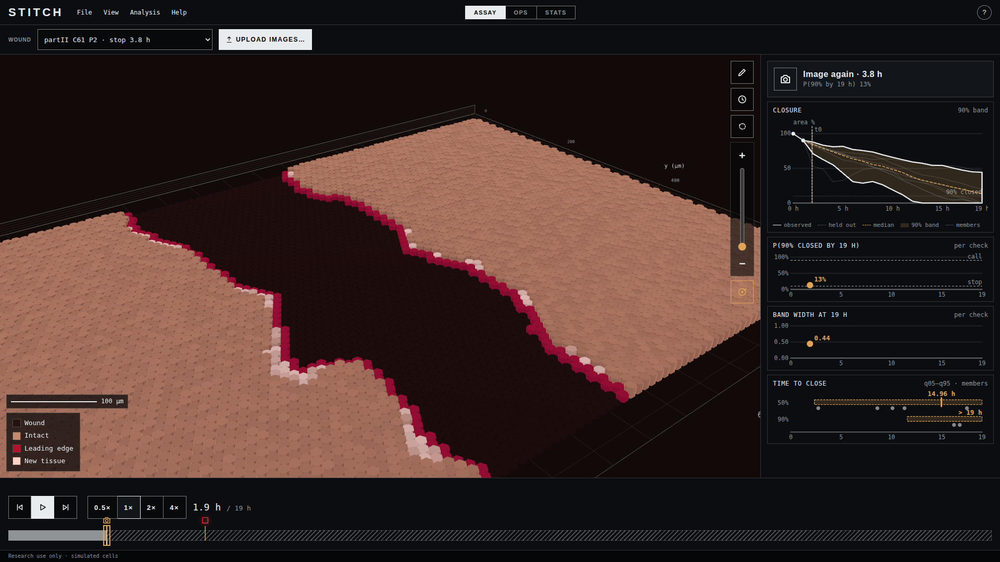
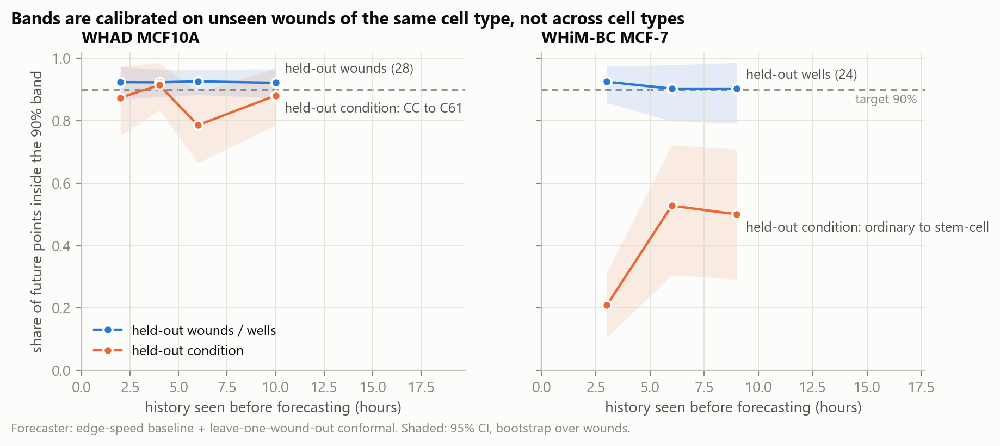
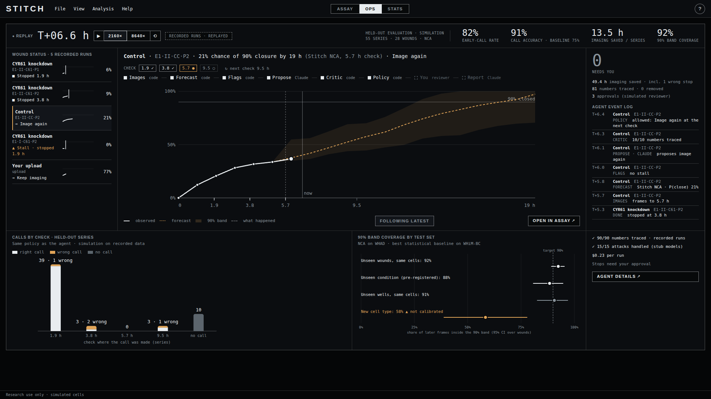
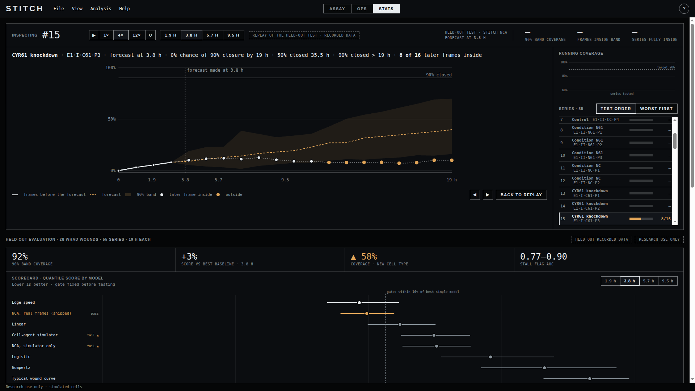
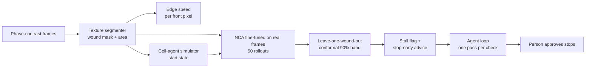

# Stitch

Stitch watches the first hours of a scratch-assay time-lapse and forecasts how the wound will close over the rest of the 19 h run, with a 90% band that holds on wounds it never saw. An agent then runs the plate check by check and asks a person before it stops anything.

> Research prototype for lab assays. Not a medical device, not for diagnosis or treatment, and no drug-effect claims. Every result below is on recorded public data.

[](LICENSE)



Built in 24 hours at the Imperial AI Hackathon 2026 (AI for Science track) by Rand, Caden and Joanne. Designed in Figma: [Stitch UI](https://www.figma.com/design/vTCApH2oLBShNu4Oi9dsGg).

**Contents**

- [Quick start](#quick-start)
- [Results](#results)
- [The app](#the-app)
- [How it works](#how-it-works)
- [The agent](#the-agent)
- [Evaluation](#evaluation)
- [Adaption fine-tunes](#adaption-fine-tunes)
- [Reproduce the results](#reproduce-the-results)
- [Datasets](#datasets)
- [Limitations](#limitations)
- [Repo layout](#repo-layout)
- [Team](#team)
- [License](#license)

## Quick start

Requires Python 3 (any recent version) and a browser. No keys, no build step.

```bash
git clone https://github.com/ephemerallyCaden/imperial-ai-hack.git
cd imperial-ai-hack
python3 -m http.server 8010 --bind 127.0.0.1
```

Open http://127.0.0.1:8010/web/index.html. Serve the repo root, not `web/`, because the app reads files from `agent/` and `eval/` too.

You land on **Assay**, playing a recorded agent run on a held-out wound. The tabs at the top switch to **Ops** (the agent's live replay) and **Stats** (the held-out test). three.js loads from unpkg; offline, everything except the 3D field still works.

Not supported: a live agent run from the browser. The demo plays recorded runs from `agent/runs/`, so viewing needs no API key. To record new runs, see [The agent](#the-agent).

## Results

Held-out test: 55 time-lapse series from 28 physical WHAD wounds (MCF10A cells, 19 h each). Every wound is forecast by a model that never trained on it and calibrated on the other wounds only (leave-one-wound-out).

| At 3.8 h of 19 h | Quantile score (lower is better) | 90% band coverage |
|---|---|---|
| Edge speed + calibration (best statistical baseline) | 0.0386 | 92% |
| NCA fine-tuned on real WHAD frames + calibration (shipped) | 0.0397 | 92% |
| NCA trained on simulator output only + calibration | 0.0502 (fails our gate) | 93% |
| Typical-wound curve | 0.0732 | 93% |

Source: `web/ops/evidence.json` and `eval/results/scorecard.csv`; every split and cut-off is in [`docs/results.md`](docs/results.md).

- The shipped NCA has the lowest score in our comparison at the first check (1.9 h: 0.0530 vs 0.0562 for edge speed, confidence intervals overlap) and the last (9.5 h: 0.0289 vs 0.0316 for the best statistical model). Edge speed wins at 3.8 h and 5.7 h.
- The band is honest on unseen wounds: 92% of later frames fall inside the 90% band (95% CI 89-95%).
- Stop early: with a rule fixed in advance (call it when P(90% closed by 19 h) is at most 0.1 or at least 0.9), 39 of 55 series (71%) get a call at the first check and 38 of those are right. By 9.5 h, 45 of 55 (82%) are called and 41 of 45 (91%) are right, against 75% for always saying "won't close". That frees 13.5 h of a 19 h run per series on average. This is a simulation on recorded data, not a lab trial (`eval/results/scheduler.csv`, `eval/results/calls_by_check.csv`).
- The stall flag ranks stalls well (AUC 0.77-0.90 across checks) but is right only 48-75% of the time when it fires, so a fired flag means "ask a person", never an automatic stop.



## The app

One page, three modes. Every number on screen is read from a file in the repo.

**Assay** plays one recorded agent run on a wound. The 3D field shows simulated cells (labelled as simulated) closing the wound, and the panel shows the closure forecast with its 90% band, P(90% closed by 19 h) per check, band width per check and time to close. Approve or reject a proposed stop and the playback follows that branch. Right-drag a box to zoom in: the area stays in colour and the rest goes grey, with stats for the selection; Esc clears it. **Draw** (in the wound picker) lets you cut a wound with the mouse and watch the NCA heal it live. **Upload images** runs the segmenter and an edge-speed forecast in the browser on 1 to 5 of your own frames.

**Ops** replays all recorded agent runs on one clock. The wound list shows each wound's status (Imaging, Image again, Needs you, Stopped), the big chart follows the latest decision, and a pipeline strip lights up the step running now: Images, Forecast, Flags, Propose (Claude), Critic, Policy, You, Report. Quiet stretches are skipped and the replay stops on "Replay complete". Below it: calls by check and band coverage by test set. "Agent details" opens the full run log, scoreboard, attack set and Investigator results.



**Stats** replays the held-out test one series at a time: the band from the chosen check is drawn, then the real frames are revealed inside (white) or outside (amber), and the counters build up to the published 92%. The list on the right holds all 55 series; sort by worst first, click one to inspect it, and step with the arrow keys. `?series=exp1_partI_C61_P3#stats` opens straight to one series. The scorecard, calibration, stall flag and worst-case wound sit underneath.



## How it works



1. Segment. A classical texture segmenter (`data/segment.py`) finds the wound in each phase-contrast frame: texture is the local standard deviation of the downsampled image, the wound is the low-texture region, then morphological clean-up keeps the large components. Against WHAD's manual masks it scores IoU 0.84 on part I and 0.60 on part II. Frames that are blank, out of focus or badly segmented are refused with the reason, not forecast.
2. Measure the front. `web/edge/edge_speed.js` computes how far each leading-edge pixel moved since the previous frame, along its normal, with no cell tracking. The held-out view in Assay (Sim vs NCA vs data) can paint it as a heatmap to show where the front is stuck.
3. Forecast. The shipped forecaster is a neural cellular automaton (NCA) fine-tuned on real WHAD frames in 4 wound-level folds. Per-wound speed parameters are fitted from the frames seen so far, then 50 stochastic rollouts give an ensemble. A constant-edge-speed model (2 parameters) is the fallback and the baseline everything is scored against.
4. Calibrate. Each wound's forecast is corrected by the errors of all other wounds (leave-one-wound-out conformal), and the 5th and 95th percentiles become the 90% band. Time to 50% and 90% closed use the same idea on time ratios. Without this step the raw NCA band covers only 19% of the future at 3.8 h; with it, 92%.
5. Flag and advise. The stall probability comes from the calibrated ensemble; the stop-early advice comes from P(90% closed by 19 h).
6. Cell layer. A lattice cell-agent simulator (Migliaccio et al. 2023 rules plus density-dependent movement, `sim/`) is fitted to each wound's early frames and gives the NCA its training data and start state. The cells you see in the 3D views are simulated, never detected: the data has wound masks, not cells.

Every model, baseline and NCA alike, writes one forecast format (`contracts/forecast.schema.json`) and is scored by one script (`eval/score_forecasts.py`).

## The agent

```bash
.venv/bin/python -m agent.run --wound exp1_partII_C61_P1 --run-id my-run --both-branches   # needs STITCH_PROVIDER and a model key in .env
```

At each check (1.9, 3.8, 5.7 and 9.5 h) the lead agent runs one pass of the same loop, and loops again until a stop is approved or the run reaches 19 h:

| Step | Who runs it | What it does |
|---|---|---|
| Images, Forecast, Flags | code | QC the frames, run the calibrated forecast, compute the stall flag and the stop-early advice |
| Investigator | code | Only when a wound goes off track: re-runs the simulator from other starting conditions and ranks them as hypotheses, never causes |
| Propose | Claude | Picks one decision from the list the policy allows and explains it |
| Critic | code | Removes any number in the explanation that does not match a tool output |
| Policy | code | Rejects anything not allowed; a refusal or a fired stall flag forces "ask a person" |
| You | a person | Approves or rejects anything that stops a plate |
| Report | Claude | Writes the end-of-run summary |

Every step goes to an append-only run log (`agent/runs/<run_id>.jsonl`) with its inputs, outputs, model, tokens, cost and time, so any number in any summary can be traced back to the tool call that produced it. Ops reads the same logs.

The five recorded demo runs (plus one recorded reject branch) use the shipped NCA forecaster and Claude Opus 5.5: 0 untraced numbers, about $0.23 of model calls per run. Approvals in the recordings come from a simulated reviewer (approve, plus one recorded reject branch), and the screens say so. Code for the loop, policy, Critic and recorder is in `agent/`; see [`agent/README.md`](agent/README.md).

## Evaluation

The agent is replayed on all 55 held-out series against two simpler policies. A simulated reviewer approves every proposal; the "Forecast policy" row uses a replay model that always takes the scheduler's advice, so it measures the code, not the LLM.

| Policy (55 series) | Plate-hours saved | Wrong stall stops | Wrong closure calls | Missed stalls | Frames used |
|---|---|---|---|---|---|
| Fixed schedule (image to 19 h) | 0 | 0 | 0 | 14 | 1090 |
| Simple rules (stop on stall flag) | 330.6 | 10 | 0 | 2 | 745 |
| Forecast policy (code; replay model, no LLM) | 741.0 | 9 | 4 | 0 | 315 |

Source: `agent/results/scoreboard.csv` (`python -m agent.evaluate`). The plate-hour gain comes from the forecaster and the policy; Claude chooses among the allowed options and explains them.

An adversarial set of 15 hostile inputs (prompt injection in protocol text and file metadata, blank and blurred frames, a wrong pixel scale, oversized uploads, a decompression bomb, out-of-scope requests, a reply with a number no tool produced, a decision outside the allowed list) is handled as expected in 15 of 15 cases, run with stub models (`agent/results/adversarial.csv`).

The Investigator is tested on 10 simulated wounds with a known cause (5 causes x 2 seeds): it ranks the true cause first in 4-8 of 10 depending on the check, against 2 in 10 by chance (`agent/results/investigator.md`).

## Adaption fine-tunes

Three `Qwen/Qwen3.5-2B` LoRAs trained with Adaption, scored against the base model:

| Task | Test set | Base model | Fine-tune | Used by the agent |
|---|---|---|---|---|
| Intake: protocol paragraph to settings (frame interval, pixel size, condition) | 30 real Methods paragraphs, labelled by hand | 47.4% mean field accuracy | 80.4% (platform win rate 0.9471) | Yes, runs locally; Claude is the fallback |
| Triage: pick the allowed decision | 14 held-out WHAD wounds | 9.5% accuracy | 99.8% | No, evaluation only |
| Reporter: two-audience report | 14 held-out WHAD wounds | 3.2% pass all four checks | 47.1% (win rate 0.50) | No, evaluation only |

The Triage go rule was changed after seeing the results, because the base model collapses to one class; [`docs/adaption-results.md`](docs/adaption-results.md) says so and keeps both versions. Adapters are not in git (about 44 MB each): `python -I data/adaption/launch.py --task intake --download`.

## Reproduce the results

Requires Python 3.12 and about 4 GB of disk outside the repo for the raw data.

```bash
pip install -r requirements.txt pytest
export CLOSURECALL_DATA=/path/outside/repo
python data/fetch.py
python -I data/build_curves.py && python -I data/build_whad.py && python -I data/build_whad_auto.py && python -I data/build_whimbc.py
python eval/forecast_baselines.py                  # calibrated baseline forecasts
python eval/score_forecasts.py eval/forecasts      # scorecard
python eval/flags.py && python eval/scheduler.py && python eval/calls_by_check.py
python eval/results_table.py && python eval/figures.py && python eval/web_evidence.py
python -m pytest -q tests/                         # fast checks, no raw data needed
```

The NCA has its own steps (`nca/gen_data.py`, `nca/train.py`, `nca/forecast_gate.py`; see [`docs/nca.md`](docs/nca.md)), and so does the simulator (`sim/calibrate.py`, `sim/forecast.py`; see [`docs/sim.md`](docs/sim.md)). The agent's offline tests run with a stub model: `python -m pytest -q agent/tests`.

## Datasets

| Dataset | Licence | Use |
|---|---|---|
| WHAD (Iheme et al. 2024), [10.5281/zenodo.12806149](https://doi.org/10.5281/zenodo.12806149) | CC BY 4.0 | Main benchmark: MCF10A scratch assays, 9 wounds with manual masks + 22 auto-segmented; 28 pass QC, 55 scored series |
| WHiM-BC (Garcia-Moreno et al. 2024), [10.5281/zenodo.8131123](https://doi.org/10.5281/zenodo.8131123) | CC BY 4.0 | MCF-7 monolayer (12) vs cancer-stem-cell sphere (12) wells: the new-cell-type test |
| Zaritsky et al. 2015, *GigaScience* 4:8, [10.5524/100118](https://doi.org/10.5524/100118) | CC0 | DA3 and MDCK curves; extra NCA fine-tuning data |
| Drosophila embryo laser wounds, [10.5281/zenodo.7660424](https://doi.org/10.5281/zenodo.7660424) | CC BY 4.0 | Secondary calibration check (62 wounds) |
| Jin et al. 2016 PC-3 density profiles, via [jlager/BINNs](https://github.com/jlager/BINNs) | Not stated; cited, not re-hosted | Simulator priors |

Raw data is downloaded by `data/fetch.py` and never committed. Derived curves in `data/processed/` are redistributed under each source's licence with the attribution above.

## Limitations

- Calibration does not transfer across cell types. Bands calibrated on ordinary MCF-7 cells cover only 15-58% of cancer-stem-cell wells at the 3 h and 6 h checks (simple models only; the NCA was not run on WHiM-BC). Calibrate per cell line.
- On a held-out condition (control to CYR61 knockdown) the shipped NCA's band under-covers at the earliest and latest checks (81% at 1.9 h, 72% at 9.5 h). Uploads of an uncalibrated condition get a widened band and a flag.
- There is no "measure again" flag: nothing we tried, including the NCA's own ensemble spread, predicts which forecasts will go wrong consistently (AUC 0.61-0.72).
- Closure curves cannot tell cell migration from cell division, and WHAD is mitomycin-treated, so Stitch makes no claim about which one a treatment changes.
- Small data: 28 WHAD wounds, 9 with manual masks; coverage confidence intervals are about ±0.05 to ±0.15.

## Repo layout

```
agent/      lead loop, policy, Critic, recorder, replay evaluation, recorded runs (agent/runs/)
contracts/  forecast.schema.json + validate.py: the forecast format every model writes
data/       fetch, build (raw -> curves), texture segmenter, upload pipeline, Adaption data
eval/       baselines, conformal forecasts, scorer, flags, scheduler, figures, results tables
nca/        neural cellular automaton: model, training, real-data fine-tuning, gate forecasts
sim/        cell-agent simulator, fits, JS engine (copied to web/public/sim/)
web/        the app: Assay, Ops, Stats; plain ES modules, no build step
docs/       design doc, decisions, results, Q&A prep, Adaption results, video plan
```

## Team

- Rand: data, segmentation, baselines, calibration and evaluation.
- Caden: cell-agent simulator, NCA, the Adaption fine-tunes and video.
- Joanne: web app, Figma design and agent layer.

Claude (Anthropic) was used as a coding assistant, and Claude Opus 5.5 is the agent's model in the product.

## License

Code: MIT ([`LICENSE`](LICENSE)). Data keeps its own licence; see [Datasets](#datasets).
